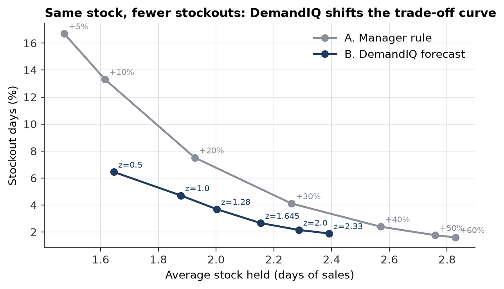
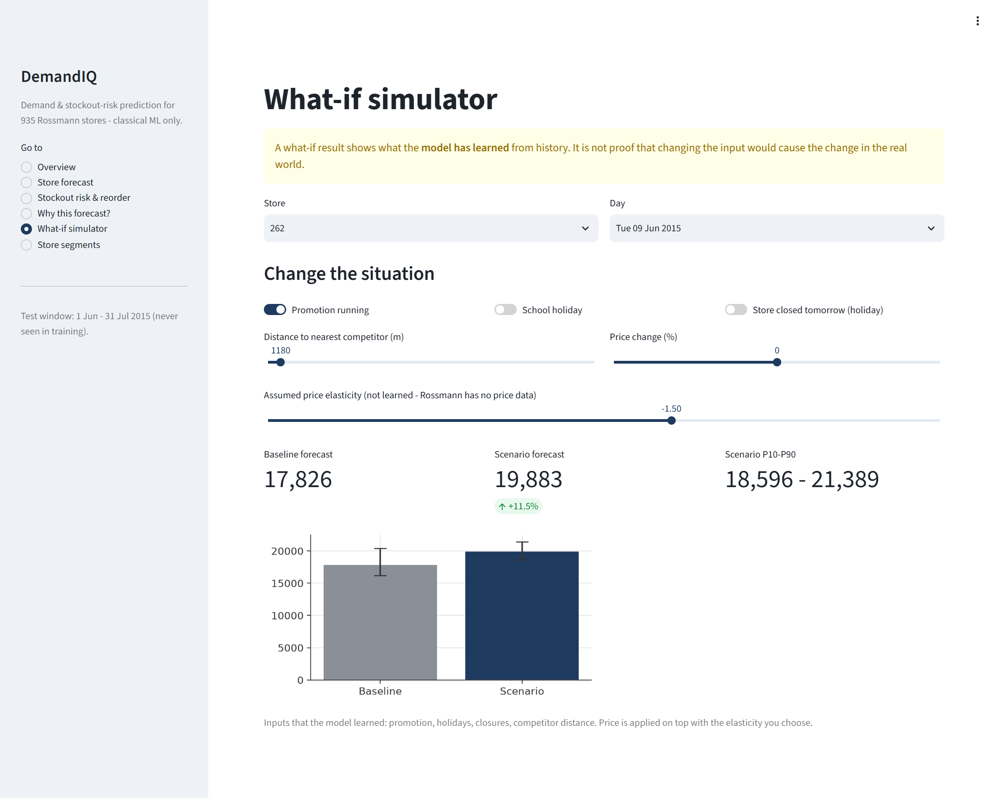
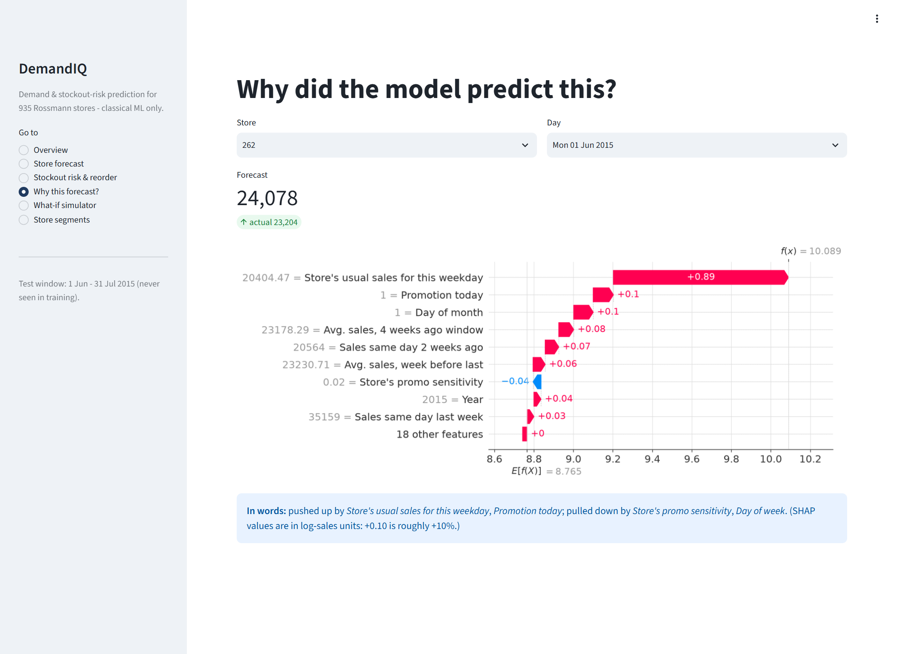
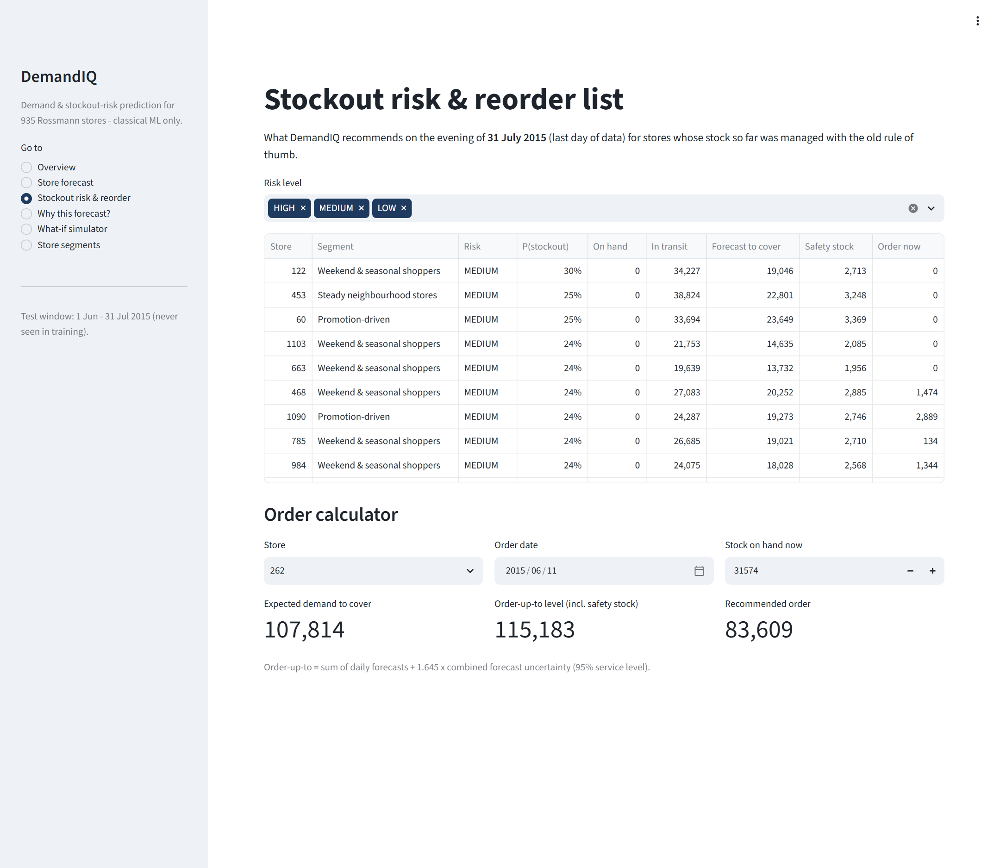
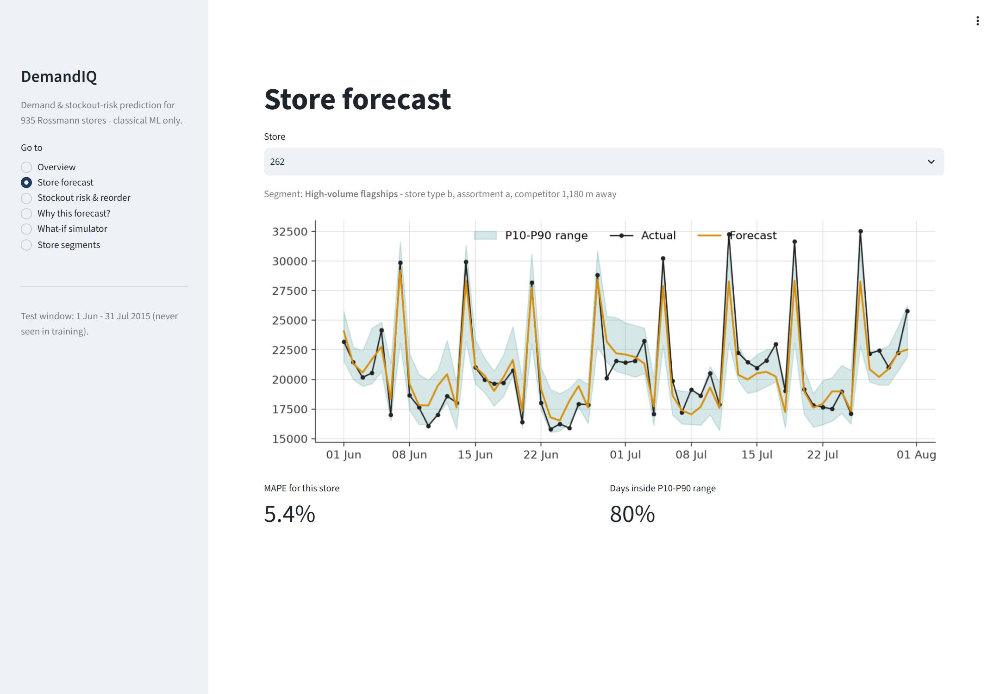
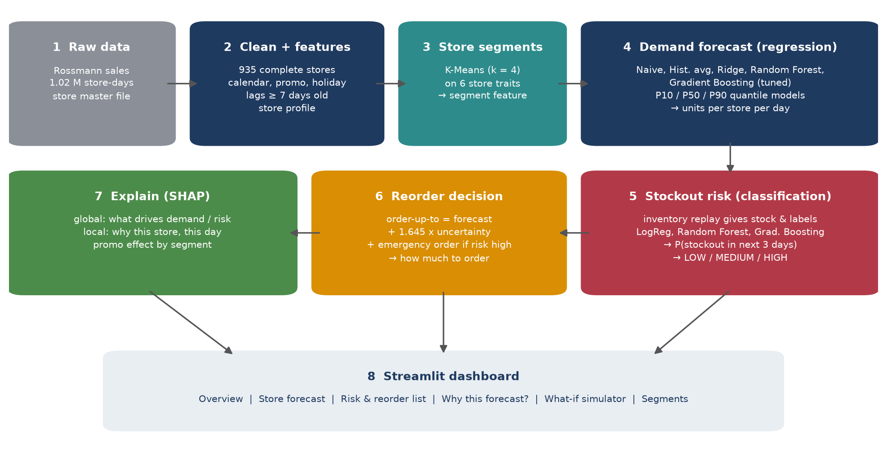
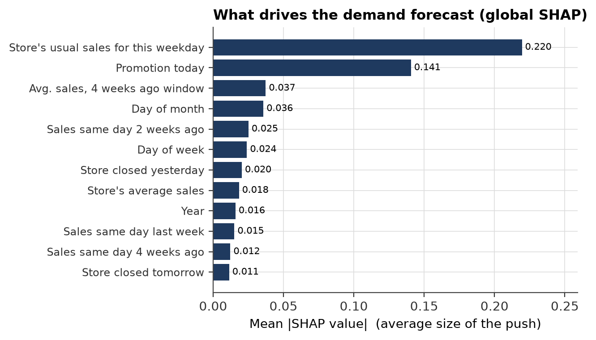
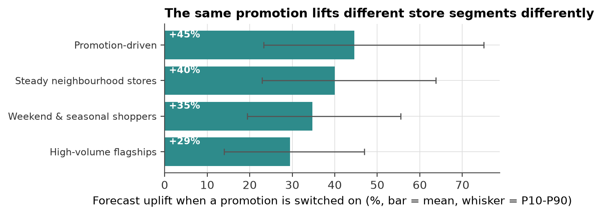

# DemandIQ

### Machine Learning for Product Demand and Stockout Risk Prediction

DemandIQ predicts **what will sell**, warns **which stores are about to run out**, recommends **how much to order**, and explains **why**. It uses classical machine learning only (no deep learning) on 1 million+ real retail sales records.

> Machine Learning group activity · B.Tech Semester V · AY 2026-27
> SVKM's NMIMS, Mukesh Patel School of Technology Management & Engineering, Mumbai

| Team member | Roll No. | Main responsibility |
|---|---|---|
| Yash Shah | L056 | Problem framing, literature survey, research gaps, report |
| Mahak Wadhawan | L074 | Demand forecasting models, tuning, evaluation |
| Yash Patil | L043 | Data cleaning, feature engineering, K-Means, inventory simulation |
| Varshita Vaan | L069 | Stockout classifier, SHAP explainability, dashboard, presentation |

   

---

## Contents

1. [Results at a glance](#results-at-a-glance)
2. [What the project does](#what-the-project-does)
3. [How to run it (step by step)](#how-to-run-it-step-by-step)
4. [Dashboard](#dashboard)
5. [How it works](#how-it-works)
6. [Project structure](#project-structure)
7. [Report, presentation and viva guide](#report-presentation-and-viva-guide)
8. [Data source and limitations](#data-source-and-limitations)

---

## Results at a glance

All numbers come from the **held-out test window (1 June – 31 July 2015)**, which the models never saw during training or tuning.

**Demand forecasting** (regression, 935 stores)

| Model | Test MAPE | R² |
|---|---|---|
| Naive (same day last week) | 31.55% | 0.213 |
| Historical average (store × weekday × promo) | 10.22% | 0.892 |
| Ridge regression | 12.40% | 0.555 |
| Random Forest | 8.15% | 0.934 |
| **Gradient Boosting (chosen)** | **7.96%** | **0.941** |

**Stockout risk in the next 3 days** (classification, 16% positive rate)

| Model | ROC-AUC | PR-AUC |
|---|---|---|
| Manager rule of thumb | 0.563 | 0.197 |
| Logistic Regression | 0.849 | 0.492 |
| Random Forest | 0.875 | 0.634 |
| **Gradient Boosting (chosen)** | **0.873** | **0.610** |

**Ordering policies** (same real demand, same late deliveries)

| Policy | Stockout days | Fill rate | Stock held | Total cost |
|---|---|---|---|---|
| A. Manager rule ("last 4 weeks' average + 20%") | 7.51% | 96.57% | 1.93 days | baseline |
| B. DemandIQ forecast + safety stock | 2.66% | 98.82% | 2.15 days | −51% |
| **C. DemandIQ + risk-triggered emergency orders** | **1.50%** | **99.58%** | **2.32 days** | **−63%** |

**80% fewer stockout days and 63% lower cost than the rule of thumb.** At every level of stock held, DemandIQ has fewer stockouts:



---

## What the project does

| # | Objective | Output | Technique |
|---|---|---|---|
| 1 | Predict demand | Daily sales per store for the next 7 days, with a P10–P90 range | Gradient Boosting regression + quantile models |
| 2 | Predict stockout risk | Probability of running out in the next 3 days → LOW / MEDIUM / HIGH | Gradient Boosting classifier |
| 3 | Recommend the order | Order-up-to level and order quantity; emergency order when risk is high | Inventory theory fed by the ML forecast |
| 4 | Explain + what-if | Reasons behind every forecast and risk score; promotion / holiday / competitor / price scenarios | SHAP (TreeSHAP), Streamlit |
| + | Store segments | 4 store types (e.g. "Promotion-driven", "High-volume flagships") | K-Means clustering |

---

## How to run it (step by step)

Everything is included in this repository (data, trained models, results), so **the dashboard works straight after installation**. Rerunning the full pipeline is optional.

### 0. What you need

* **Python 3.10 or newer**. Check with `python --version` (on macOS/Linux, `python3 --version`).
* **Git**: https://git-scm.com/downloads
* About 1 GB of free disk space and 4 GB of RAM.

### 1. Download the project

Open a terminal (Windows: **PowerShell**; macOS/Linux: **Terminal**) and run:

```bash
git clone https://github.com/mahak2604/DemandIQ.git
cd DemandIQ
```

### 2. Create a virtual environment (recommended)

**Windows (PowerShell)**
```powershell
python -m venv .venv
.venv\Scripts\Activate.ps1
```
> If PowerShell blocks the script, run `Set-ExecutionPolicy -Scope CurrentUser RemoteSigned` once, then try again.

**macOS / Linux**
```bash
python3 -m venv .venv
source .venv/bin/activate
```

When it works, you will see `(.venv)` at the start of the terminal line.

### 3. Install the libraries

```bash
pip install -r requirements.txt
```

### 4. Open the dashboard

```bash
streamlit run app/app.py
```

Your browser opens at **http://localhost:8501**. To stop the dashboard, press `Ctrl + C` in the terminal.

Things to try:
* **What-if simulator** → store 262 → switch *Promotion running* on and watch the forecast change.
* **Why this forecast?** → see which factors pushed a prediction up or down.
* **Stockout risk & reorder** → stores ranked by risk, with a recommended order.

### 5. (Optional) Rerun the whole machine-learning pipeline

```bash
python src/run_all.py
```

This rebuilds every dataset, model, figure and table in `outputs/` in about 8–12 minutes on a laptop. Results are identical on every run (`RANDOM_STATE = 42`).

You can also run the steps one at a time, in this order:

```bash
python src/step1_prepare_data.py       # clean data, build 27 features, EDA charts
python src/step2_store_segments.py     # K-Means store segments
python src/step3_demand_model.py       # demand models + tuning (slowest step, ~7 min)
python src/step4_stockout_model.py     # inventory replay + stockout classifiers
python src/step5_reorder_policies.py   # compare ordering policies A / B / C
python src/step6_explain.py            # SHAP explanations
```

### 6. (Optional) Rebuild the report and the presentation from the latest results

```bash
python report/build_report.py          # -> report/DemandIQ_Project_Report.docx
python presentation/build_deck.py      # -> presentation/DemandIQ_Presentation.pptx
```

After opening the rebuilt report in Word, press `Ctrl + A` and then `F9` to refresh the table of contents and the lists of figures and tables.

### Troubleshooting

| Problem | Fix |
|---|---|
| `python` is not recognised | Reinstall Python and tick **"Add Python to PATH"**, or use `py` instead of `python` on Windows |
| `streamlit` is not recognised | Activate the virtual environment (step 2) or run `python -m streamlit run app/app.py` |
| Port 8501 already in use | `streamlit run app/app.py --server.port 8502` |
| `ModuleNotFoundError` | Run `pip install -r requirements.txt` again inside the activated environment |

---

## Dashboard

| What-if simulator | Why this forecast? |
|---|---|
|  |  |
| **Stockout risk & reorder list** | **Store forecast with P10–P90 range** |
|  |  |

---

## How it works



1. **Data preparation.** The Rossmann sales data (1,017,209 store-days, 1,115 stores, 2013–2015) is cleaned. The 935 stores with a complete history are kept, and 27 features are built: calendar, promotions, holidays, store profile and sales history. **Every sales-history feature is at least 7 days old**, so nothing leaks from the future and one model can forecast the whole coming week.
2. **Strict time split.** Train up to Mar 2015, tune on Apr–May 2015, test once on Jun–Jul 2015. Rows are never shuffled.
3. **Store segments.** K-Means on six store traits finds four store types. The segment is used as a model feature.
4. **Demand forecast.** Five models, from a naive baseline to tuned Gradient Boosting. Quantile models (P10/P90) estimate uncertainty.
5. **Inventory replay.** Rossmann publishes sales, not stock. We replay a realistic ordering process over the real sales: orders on Monday and Thursday, a 2-day lead time, and 20% of deliveries late. The manager's rule is calibrated to the **8.3% out-of-stock rate measured in real stores** (Gruen et al., 2002).
6. **Stockout classifier.** It predicts whether a store runs out in the next 3 days from stock, deliveries due, forecasts and upcoming promotions. The decision threshold is tuned on validation.
7. **Reorder decision.** Order-up-to level:
   `S = Σ forecast + E[delay]·daily forecast + 1.645·√(Σσ² + daily forecast²·Var[delay])`.
   An emergency next-day order is placed when the predicted risk passes a threshold that is tuned on validation.
8. **Explainability.** Exact TreeSHAP values for both models, plus a what-if simulator. What-if results are labelled as model behaviour, not cause and effect.

| Global drivers of demand (SHAP) | Promotion uplift differs by store type |
|---|---|
|  |  |

---

## Project structure

```
DemandIQ/
├── app/
│   └── app.py                    Streamlit dashboard (6 pages, what-if simulator)
├── src/
│   ├── config.py                 every setting in one place (dates, costs, lead time ...)
│   ├── step1_prepare_data.py     cleaning, features, EDA charts
│   ├── step2_store_segments.py   K-Means store segmentation
│   ├── step3_demand_model.py     baselines, Ridge, Random Forest, Gradient Boosting, quantiles
│   ├── step4_stockout_model.py   inventory replay + stockout classifiers
│   ├── step5_reorder_policies.py ordering policies, trade-off curve, reorder list
│   ├── step6_explain.py          SHAP explanations
│   ├── inventory.py              inventory simulator used by steps 4 and 5
│   ├── draw_architecture.py      architecture diagram
│   ├── utils.py                  metrics and plotting helpers
│   └── run_all.py                runs everything in order
├── data/
│   ├── raw/                      Rossmann train.csv and store.csv
│   └── processed/                files created by the pipeline
├── outputs/
│   ├── figures/                  all 25 charts
│   ├── tables/                   every result as CSV / JSON
│   ├── models/                   trained models (joblib)
│   └── screenshots/              dashboard screenshots
├── report/                       project report (.docx + .pdf) and its generator
├── presentation/                 presentation (.pptx + .pdf) and its generator
├── assets/                       logo
├── VIVA_GUIDE.md                 presentation split and likely viva questions
├── requirements.txt
└── README.md
```

---

## Report, presentation and viva guide

* 📄 **Project report:** [`report/DemandIQ_Project_Report.pdf`](report/DemandIQ_Project_Report.pdf) (Word version: [`.docx`](report/DemandIQ_Project_Report.docx)). It includes a literature survey of 20 books and 15 research papers, 29 figures, 22 tables and IEEE references.
* 📊 **Presentation:** [`presentation/DemandIQ_Presentation.pptx`](presentation/DemandIQ_Presentation.pptx) (PDF: [`.pdf`](presentation/DemandIQ_Presentation.pdf)). 19 slides with speaker notes.
* 🎤 **Viva guide:** [`VIVA_GUIDE.md`](VIVA_GUIDE.md). Who presents which slides, plus short answers to likely questions.

---

## Data source and limitations

**Data:** [Rossmann Store Sales](https://www.kaggle.com/c/rossmann-store-sales) (Kaggle, 2015). This is daily sales from 1,115 German drugstores, released publicly by Rossmann for a forecasting competition. It is included here for academic, non-commercial use and reproducibility. All rights remain with the original publisher.

**Limitations (stated openly):**
1. Stock levels are **simulated** from real sales, not observed, because no public retail dataset publishes stock on hand.
2. Forecasts are at **store level**, not individual product level.
3. Rossmann has **no price data**, so the price lever in the what-if tool uses an elasticity you choose, labelled as an assumption.
4. The P10–P90 band covers 73% of test days instead of the 80% target.

**Future work:** validate on data with real stockout labels (e.g. FreshRetailNet-50K), add an Indian festival calendar, estimate a causal price effect with double/debiased ML, and use conformal prediction for better intervals.
